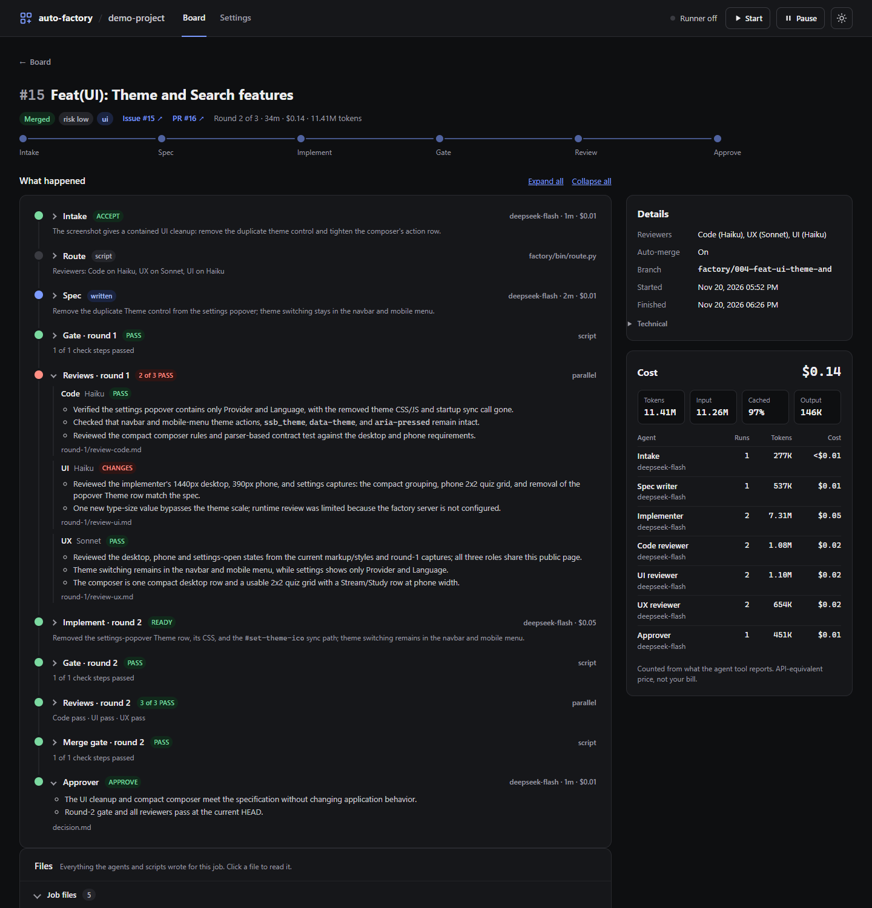
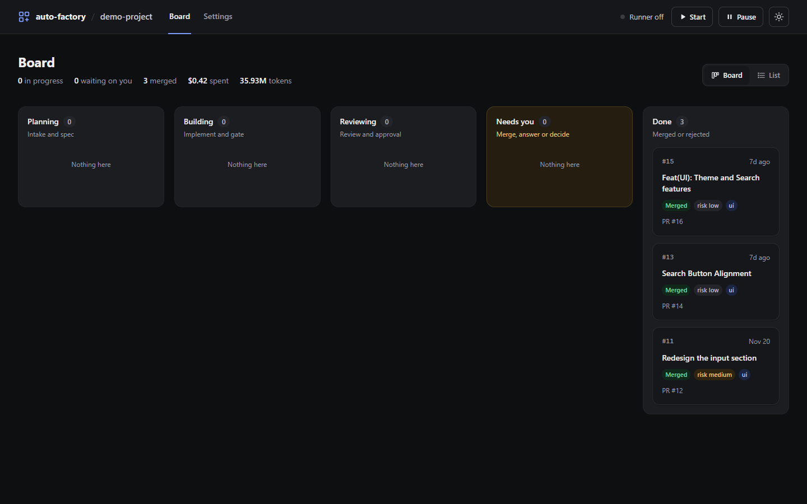
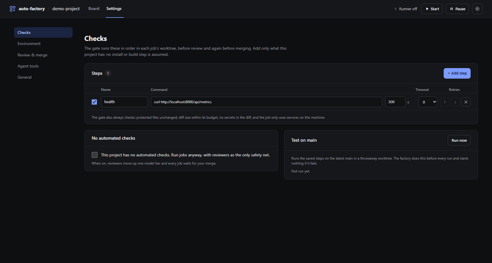
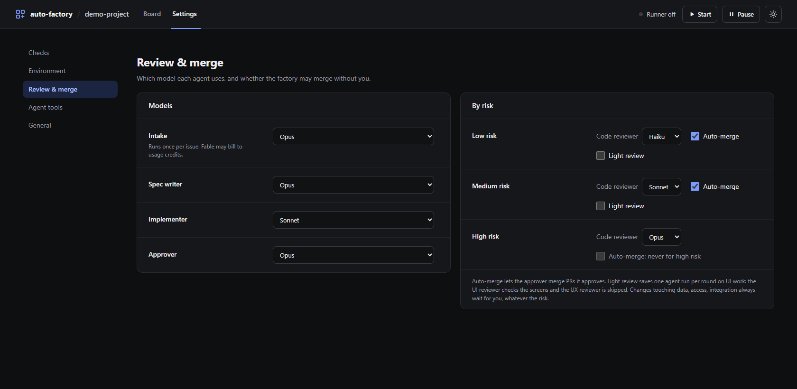
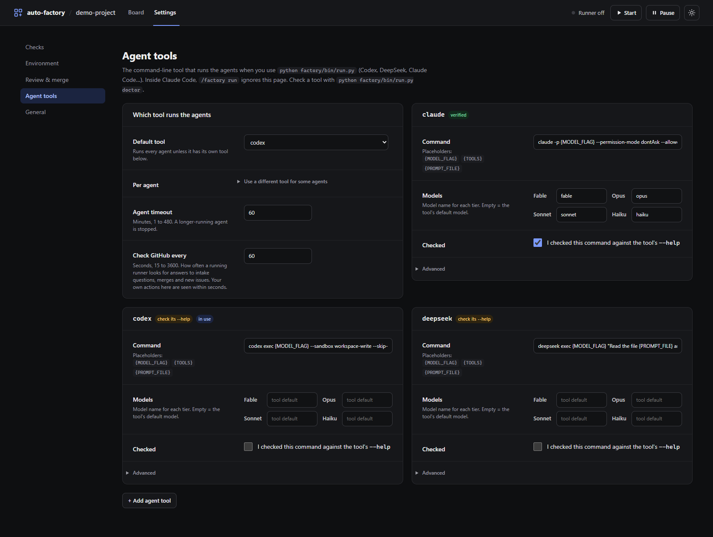
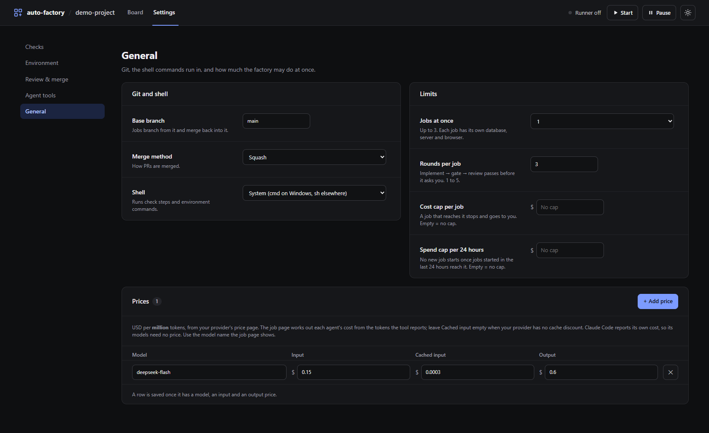
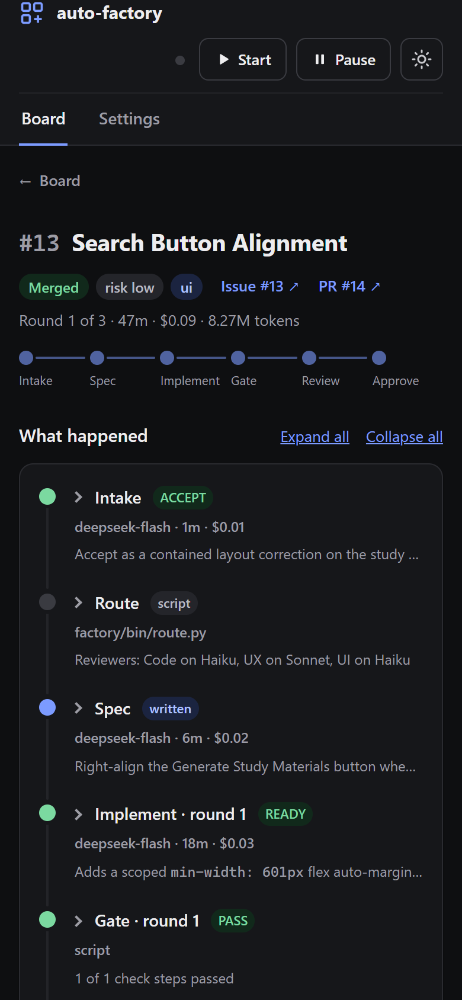
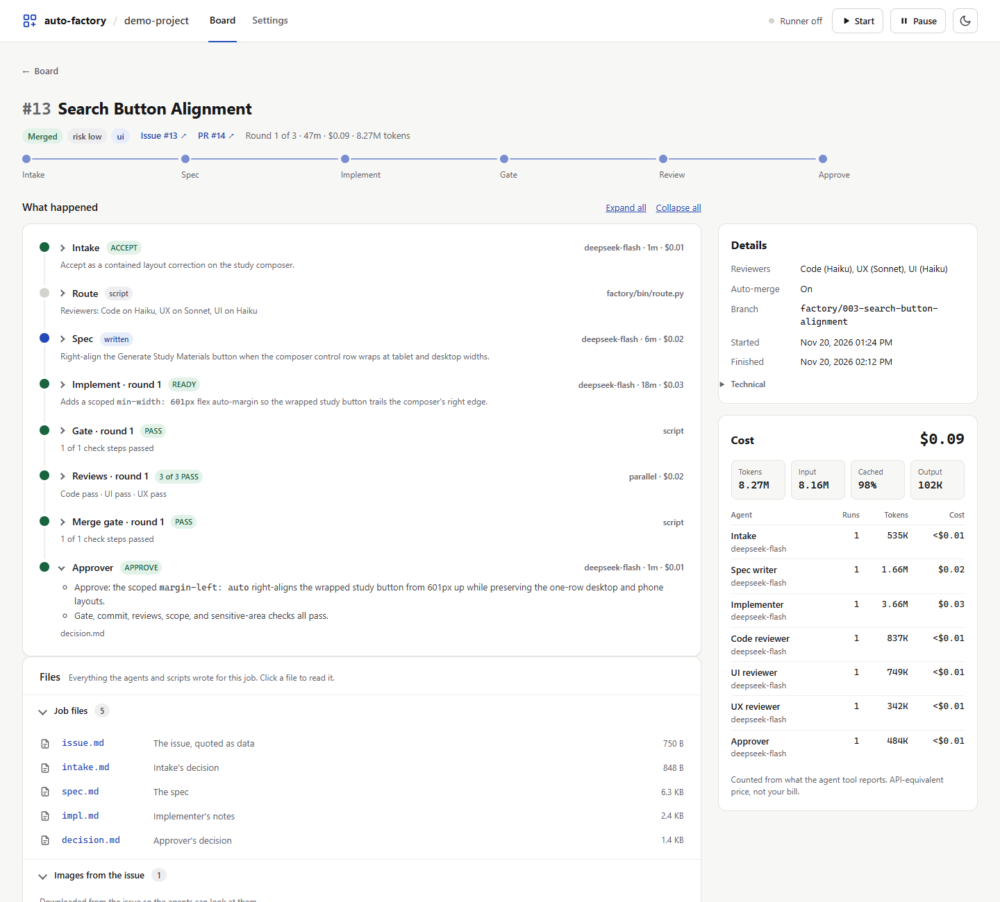

# auto-factory

An issue-driven software factory for any kind of project, run by Claude Code
or any other agent CLI (Codex, DeepSeek, …). A short project profile tells the
agents what your project is; starter profiles ship for backoffice, web apps,
API services, libraries, mobile apps and data pipelines.
Label a GitHub issue `factory`, press **Start** in the dashboard (or run
`/factory run`), and agents decide whether it's worth building, write a spec,
implement it on its own branch, pass it through your checks, review it, and
open a pull request. The approver merges what it's allowed to; everything else
waits for you with a specific question.



Built from the design in [PLAN.md](PLAN.md). The interfaces between the pieces
are fixed in [CONTRACTS.md](CONTRACTS.md).

## The loop

```
issue labeled `factory`
  intake            ACCEPT (maybe rescoped) | NEEDS-INFO (asks on the issue) | REJECT
  route.py          reviewers + models from risk and areas; may it auto-merge?
  job.py            worktree, branch, the job's own .env, database, migrations, seed
  spec-writer       spec.md with testable acceptance criteria (and who may do what, if the project has roles)
  implementer       commits, pushes, draft PR "Closes #n", impl.md
  gate.py           your check steps + built-in rules; FAIL goes straight back
  reviewers         code (+ ux, ui, security, data, authorization by area), all in parallel
  approver          APPROVE → job.py merge (or held for you) | ESCALATE → you
```

Nothing assumes an install or build step: each project's check steps (lint,
tests, a migration check…) are set in the dashboard. With no steps the gate
refuses to run, unless you switch on "No automated checks", which then sends
every job to you.

## Layout

```
install.py                     install or upgrade the factory in a project
profiles/                      starter project profiles (backoffice, web-app, api-service, …)
template/                      what gets installed
  .claude/skills/factory/      the /factory orchestrator (Claude Code)
  .agents/skills/factory/      the $factory skill (Codex), which drives run.py
  .claude/agents/              intake, spec-writer, implementer, approver, 6 reviewers
  factory/bin/                 job, gate, route, env, port, shot, serve, run, put (python …/x.py)
  factory/factorylib/          shared Python, standard library only
  factory/dashboard/           the dashboard page (served by serve.py)
  factory/config.json          defaults; edited from the dashboard afterwards
tests/                         unit and end-to-end tests (fake GitHub, real git)
docs/screenshots/              the dashboard pictures in this README
PLAN.md  CONTRACTS.md
```

## Requirements

- Python 3.10+ (`python` on PATH) and git.
- An agent CLI: Claude Code, Codex, or another tool that runs without prompts
  (see [Use it with Codex, DeepSeek or another agent tool](#use-it-with-codex-deepseek-or-another-agent-tool)).
- The GitHub CLI `gh`, logged in with an account that can push and manage labels.
- Recommended: ripgrep (`rg`). Agents search with it first.
- Optional: Playwright for Python (`pip install playwright && python -m playwright
  install chromium`) so reviewers can take signed-in screenshots. Without it they
  review from code and say so.

Works on Windows (cmd, PowerShell or Git Bash), macOS and Linux.

## Install into a project

```bash
python install.py "C:/path/to/your-repo" --profile web-app
```

It copies `template/`, adds the runtime folders to `.gitignore`, puts the
chosen **project profile** into `AGENTS.md` (and makes `CLAUDE.md` import it),
and prints the remaining steps: fill in the profile's [bracketed] parts, create
the three GitHub labels, commit and push, then open the dashboard and set the
check steps. Profiles: `backoffice`, `web-app`, `api-service`, `library`,
`mobile-app`, `data-pipeline`, `blank` (see [profiles/README.md](profiles/README.md)).

Later, to take new scripts without losing your settings or tailored prompts:

```bash
python install.py "C:/path/to/your-repo" --upgrade
```

Add `--prompts` to also take the newest agent prompts (your old ones are saved
in `factory/archive/prompts-<time>/` first).

## How the agents stay project-neutral and cheap

- **Project profile, not hard-coded domain.** The agent instructions are
  generic; everything specific (what the app is, roles, sensitive areas, where
  auth and data rules live, UI conventions) is in the `## Factory profile`
  section of `AGENTS.md`. Sections marked `None` / `No UI` switch checks off.
- **Working rules in every agent:** search before reading, read only around the
  relevant lines, never dump large or generated files, stop once the task can be
  done, short outputs.
- **Re-reviews look only at what changed** since the commit a reviewer last saw.
- **Quick exits:** a reviewer whose area the diff doesn't touch passes at once.
- **Cache-friendly prompts:** instructions first, job details last.
- **Job files come with the prompt:** each role gets current copies of the
  job files it reads (issue and intake for the spec writer, the spec for the
  implementer, spec and impl.md for reviewers and the approver), so it doesn't
  spend turns finding and reading them. Files over 20,000 characters are left
  to read in parts.
- **No turns lost to file writing or the shell:** agents whose tool has no
  working editor (Codex with a model it doesn't know, such as DeepSeek) pipe
  text to `factory/bin/put.py`, which writes files or applies apply_patch-style
  patches and keeps CRLF files CRLF. On Windows the preamble says the shell is
  PowerShell, and the runner puts Codex's bundled `rg` on the agents' PATH
  when ripgrep isn't installed.
- **Light review (opt-in, per risk):** Settings → Review & merge → Light review.
  UI work then gets the UI reviewer only, not the UX reviewer too: one agent
  run less per round. Security, data and access reviewers always stay, and
  high risk always gets every reviewer.
- **Exact tokens and cost, live:** the job page's Cost card shows input, cached
  share and output, with runs, tokens and cost per agent. It updates every few
  seconds while an agent works. Claude Code reports its own usage and cost.
  For Codex the runner reads Codex's session files, which include the cached
  input its "tokens used" line leaves out. Add each model's price per million
  tokens in Settings, General, Prices to see the cost of tools that don't
  report one.

## Run it

In the project, in Claude Code:

```
/factory run          every open `factory` issue, `concurrency` at a time
/factory run 12       one issue
/factory <anything>   ask about jobs, give feedback on one, reject one, file a feature
```

## The `factory` skill in Claude Code and in Codex

Both tools get the same commands from their own skill file:

| | Claude Code | Codex |
|---|---|---|
| Skill file | `.claude/skills/factory/SKILL.md` | `.agents/skills/factory/SKILL.md` |
| Type | `/factory run`, `/factory run 12`, `/factory <anything>` | `$factory run`, `$factory run 12`, `$factory <anything>` (or pick it in `/skills`) |
| Who runs the agents | Claude Code's own subagents | `factory/bin/run.py`, started by the skill |

In Codex the skill hands `run` to `run.py --watch`, which needs network access
and starts other agent processes, so Codex asks you to approve running it
outside its sandbox. If your Codex session can't keep a long command running,
press **Start** in the dashboard or run `python factory/bin/run.py --watch` in
a terminal instead; the result is the same.

The Codex skill only runs when you name it (`allow_implicit_invocation: false`
in its `agents/openai.yaml`), because it opens and merges pull requests.

## Keep it running: the runner

You don't have to start the factory again after each piece of feedback. Press
**Start** in the dashboard's top bar (or run `python factory/bin/run.py
--watch`). The runner then:

- picks up your feedback, answers to intake's questions, resumed or retried
  jobs and new `factory` issues within seconds (GitHub every minute,
  `runner.poll_seconds`);
- runs each job on its own, so one job waiting for you or failing never stops
  the others;
- keeps going until you press **Stop** (finish the steps in progress) or
  **Stop now** (end the running agents), or run `python factory/bin/run.py stop`.

Each job's page has **Pause** (finish the current step, then hold), **Stop
now** (end its running agent; the step starts over when you resume),
**Resume**, and **Retry** for a job the runner stopped. `/factory run` in
Claude Code keeps watching too (with `job.py wait`), and refuses to start
while a runner is on, so two orchestrators never drive the same jobs.

## Images in issues

Screenshots and mockups pasted into an issue reach the agents: when a job
starts, the images in the issue (and in the author's comments) are downloaded
with your `gh` login into the job folder (`attachments/`), and `issue.md`
points at them. Intake, the spec writer, the implementer and the UI/UX
reviewers are told to open them. Only GitHub-hosted images are fetched (PNG,
JPEG, GIF, WebP; at most 20, 10 MB each); the dashboard shows them under
"Images from the issue" on the job page.

## Use it with Codex, DeepSeek or another agent tool

The factory doesn't need Claude Code. `run.py` is a script version of the
`/factory` orchestrator that starts every agent through a command you choose:

```bash
python factory/bin/run.py doctor    # check settings and that the tools are installed
python factory/bin/run.py --watch   # keep working the queue until stopped (or press Start in the dashboard)
python factory/bin/run.py           # one pass: until nothing can move without you
python factory/bin/run.py 12        # one issue
python factory/bin/run.py status    # is a runner on, and what is it doing?
python factory/bin/run.py stop      # stop a running runner (add --now to end running agents)
```

Pick the tool in the dashboard (Settings → Agent tools) or in `config.json`
under `runner`: one default tool for every role, and optionally a different
tool per role (say Codex implements, Claude reviews). Presets ship for:

| Tool | Status |
|---|---|
| Claude Code (`claude -p`) | checked against Claude Code 2.1.286; records cost per agent |
| Codex (`codex exec`) | preset; used with Codex 0.170 and DeepSeek models. Exact tokens come from Codex's session files. Compare with your `codex exec --help` and set model names |
| DeepSeek (`deepseek exec`) | preset, **not verified here**: DeepSeek's terminal agents differ; set the real command |

Any other CLI works if it can run non-interactively, read a prompt from stdin
or a file, use a shell and edit files in the working folder. The agents'
instructions stay in `.claude/agents/*.md` for every tool. The runner adds a
short tool-neutral preamble, runs the gate's dry run after the implementer,
pushes and opens the PR itself when a sandbox blocks the network, and
reverts code changes made by agents that should only read.

Two installs save many agent turns: ripgrep (`rg`, agents search with it
first) and, for UI projects, Playwright for `shot.py`'s screenshots. Without
Playwright, agents improvise screenshots with slow workarounds.

Give each tool the permissions its role needs and no more. The implementer
edits and commits in its worktree; everyone else writes one file in the job
folder. All agents run from the project root.

## Dashboard

Board, job files and settings:

```bash
python factory/bin/serve.py
```

Open the printed link (it carries a private token). Settings saved there are
written to `factory/config.json`; commit that file so everyone running the
factory shares them.

### Board

Every job by stage: planning, building, reviewing, waiting for you, done.
The top bar starts and stops the runner and pauses the whole factory. The
summary adds up what all jobs spent, in money and tokens.



### A job

The progress track, then each step the agents and scripts took, newest at the
bottom. Each step opens and closes, with a one-line preview when closed.
Failures, warnings and the latest step start open. **Expand all** and
**Collapse all** sit next to the heading, and what you open or close stays that
way while the page refreshes.

The side panel shows who reviews the job and whether it may merge on its own.
The **Cost** card shows the job's tokens (input, cached share, output) and its
runs, tokens and cost per agent. While an agent works, a live line shows its
tokens so far and updates every few seconds. Below the steps are the job's
files, the runner's records of each agent run, and the images from the issue.


### Settings

Everything in `config.json`, in five sections. On wide screens the cards sit two
per row; lists such as check steps and prices use the full row.

- **Checks:** the gate's check steps, run before review and again before
  merging, and a button to test them on main.

  

- **Review & merge:** the model for each agent and, per risk level, the code
  reviewer, **Auto-merge** and **Light review**.

  

- **Agent tools:** which command-line tool runs the agents, a different tool
  per agent if you want, and each tool's command and model names.

  

- **General:** git and shell, limits and cost caps, and **Prices**: USD per
  million tokens for each model, so tools that report only tokens (Codex)
  get a cost too. Models used on jobs without a price show up as one-click
  buttons.

  

### Any screen, light or dark

Pages use the whole window on large screens and work at phone width. The sun
or moon button in the top bar switches between dark and light.

<p>
  
  &nbsp;
  
</p>

### After an upgrade, restart `serve.py`

The page is read fresh on every request, but `serve.py`'s own Python isn't.
When the factory is upgraded under a running `serve.py`, a bar at the top asks
you to restart it: Ctrl+C, run it again, and open the new link. Until then
some numbers (and saving new kinds of settings) come from the old code.

The screenshots come from a demo project with three real jobs that Codex ran
on DeepSeek. Their costs use prices entered in Settings, so check your
provider's prices for your own.

## Safety

- Only issues labeled `factory` run; labels need triage or write access.
- Issue text reaches agents only as quoted data in `issue.md`, and only the
  author's and operator's comments.
- Branches are `factory/*`; merges happen only through `job.py merge` → `gh pr merge`.
  It never deploys.
- Auto-merge starts off for every risk; high risk, data, access and integration
  changes always go to a human.
- Each job gets its own worktree, database, ports and `.env`; anything that points
  at a host off this machine is refused before a command runs.
- The gate reads the main checkout's settings, so a branch can't change its own
  checks, and it fails any change to the factory's own files.

## Tests

```bash
cd tests
python -m unittest -v
```

The end-to-end tests build a throwaway repo with a bare `origin`, install the
factory, and drive every stage with a fake `gh`; no network or GitHub account
is needed. About eight minutes on Windows (the runner tests wait on real
processes and timers).
